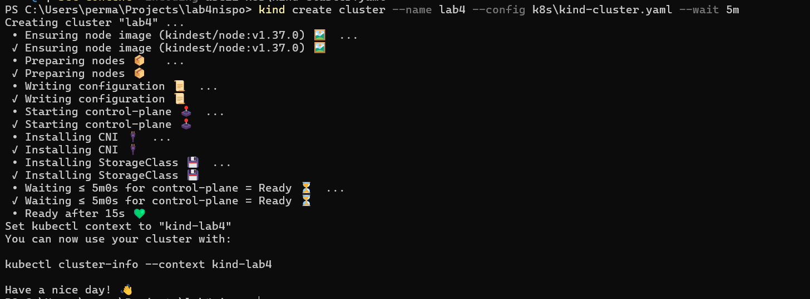
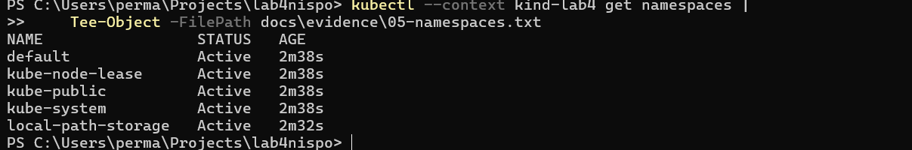
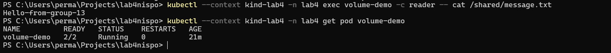
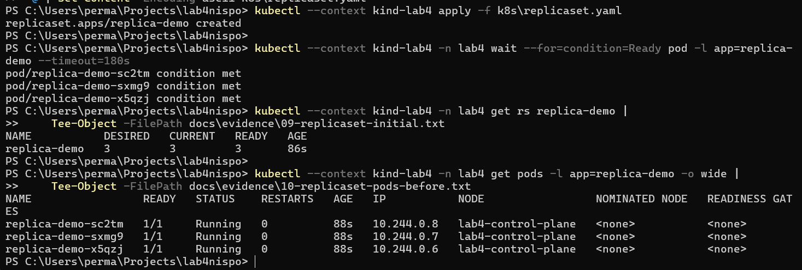
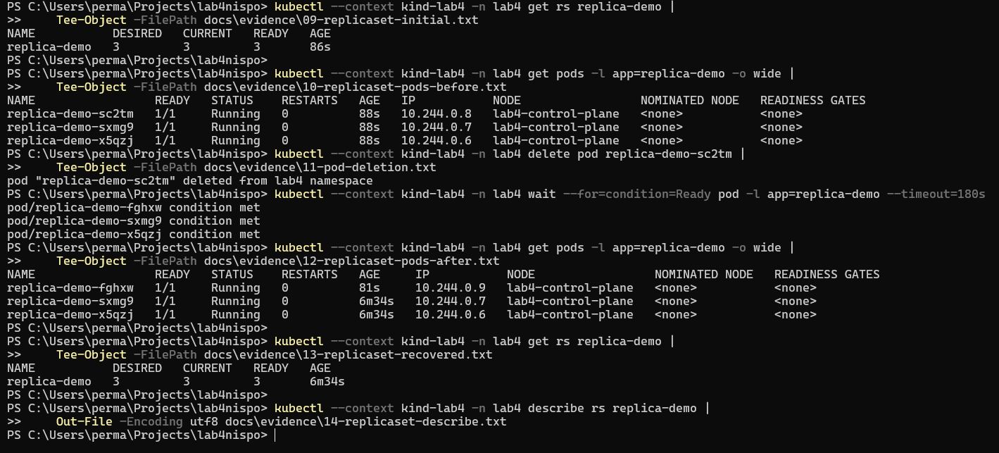
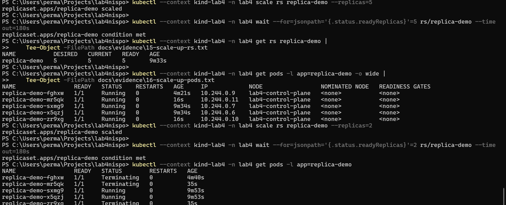
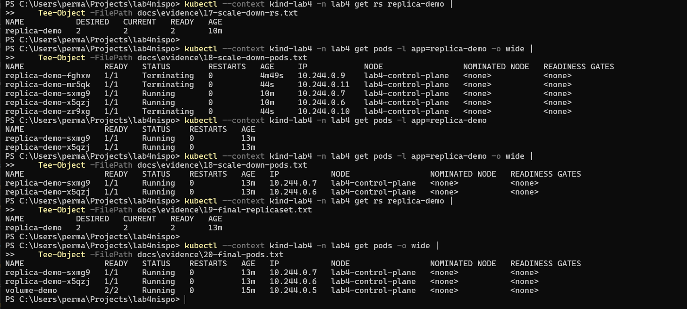
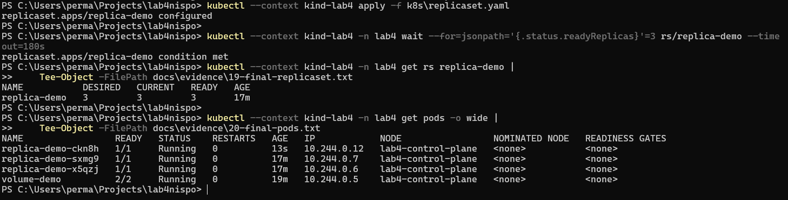

# Лабораторная работа № 4

Методы и средства оркестрации в многоконтейнерных системах.
Дисциплина: «Непрерывное интегрирование и сборка программного обеспечения».

## Автор

**Атаев Перман**, Белорусский государственный университет, факультет прикладной математики и информатики, 4 курс, группа 13.

## Отчёт

- [PDF-отчёт со скриншотами и ответами на 23 вопроса](docs/report.pdf)
- [Редактируемый текст отчёта](docs/report.md)
- [Конфигурационные файлы](k8s)
- [Скриншоты](docs/screenshots)
- [Вывод команд, сохранённый при выполнении](docs/evidence)

Для группы 13 выполнена практическая часть заданий **1–2**. Примеры Deployment, Service и Ingress в контрольных ответах являются теоретическими.

## Окружение

Windows / PowerShell / WSL 2; Docker Desktop 4.93.0; Docker Engine 29.8.1; kind 0.33.0; kubectl 1.36.1; Kubernetes 1.37.0; BusyBox 1.37.0.

## Воспроизведение

Запустить Docker Desktop в режиме Linux-контейнеров. Из корня репозитория выполнить команды в PowerShell. Команду создания кластера выполнять только если кластер lab4 ещё не существует.

```powershell
kind create cluster --name lab4 --config k8s/kind-cluster.yaml --wait 5m
kubectl --context kind-lab4 get nodes
kubectl --context kind-lab4 apply -f k8s/namespace.yaml
kubectl --context kind-lab4 apply -f k8s/pod-volume.yaml
kubectl --context kind-lab4 -n lab4 wait --for=condition=Ready pod/volume-demo --timeout=180s
kubectl --context kind-lab4 -n lab4 exec volume-demo -c writer -- sh -c 'echo Hello-from-group-13 > /data/message.txt'
kubectl --context kind-lab4 -n lab4 exec volume-demo -c reader -- cat /shared/message.txt
kubectl --context kind-lab4 apply -f k8s/replicaset.yaml
kubectl --context kind-lab4 -n lab4 wait --for=jsonpath='{.status.readyReplicas}'=3 rs/replica-demo --timeout=180s
kubectl --context kind-lab4 -n lab4 get pods
```

Не применять всю папку `k8s` через `kubectl apply -f k8s`: файл `kind-cluster.yaml` предназначен для kind, а не Kubernetes API.

### Восстановление и масштабирование

```powershell
$podToDelete = kubectl --context kind-lab4 -n lab4 get pods -l app=replica-demo -o jsonpath='{.items[0].metadata.name}'
kubectl --context kind-lab4 -n lab4 delete pod $podToDelete
kubectl --context kind-lab4 -n lab4 get pods -l app=replica-demo
kubectl --context kind-lab4 -n lab4 scale rs replica-demo --replicas=5
kubectl --context kind-lab4 -n lab4 wait --for=jsonpath='{.status.readyReplicas}'=5 rs/replica-demo --timeout=180s
kubectl --context kind-lab4 -n lab4 get rs replica-demo
kubectl --context kind-lab4 -n lab4 scale rs replica-demo --replicas=2
kubectl --context kind-lab4 -n lab4 wait --for=jsonpath='{.status.readyReplicas}'=2 rs/replica-demo --timeout=180s
kubectl --context kind-lab4 -n lab4 get pods -l app=replica-demo
```

После уменьшения дождаться исчезновения Pod со статусом `Terminating`. Вернуть исходные три реплики:

```powershell
kubectl --context kind-lab4 apply -f k8s/replicaset.yaml
kubectl --context kind-lab4 -n lab4 wait --for=jsonpath='{.status.readyReplicas}'=3 rs/replica-demo --timeout=180s
kubectl --context kind-lab4 -n lab4 get rs,pods
```

Образ узла выбирается установленной версией kind; зафиксированная в отчёте версия относится к выполненному запуску. Том `emptyDir` удаляется вместе с Pod. Команда `sleep 86400` завершается через сутки, после чего контейнер перезапускается согласно политике по умолчанию.

## Результаты

| Проверка | Результат |
|---|---|
| Кластер | Узел Ready |
| Общий том | reader прочитал Hello-from-group-13 |
| ReplicaSet | Три готовые реплики |
| Удаление Pod | Автоматически создан новый Pod |
| Масштабирование | 3 → 5 → 2 |
| Финальная конфигурация | 3 реплики и volume-demo 2/2 Running |

### Работающий кластер и системные Pod



### Пространства имён кластера



### Чтение общего тома из контейнера reader



### ReplicaSet: три готовые реплики



### Удаление Pod и создание замены



### Увеличение до пяти реплик



### Завершённое уменьшение до двух реплик



### Возврат к трём репликам и итоговое состояние



## Репозиторий

https://github.com/PermanAtayevv/lab4nispo
