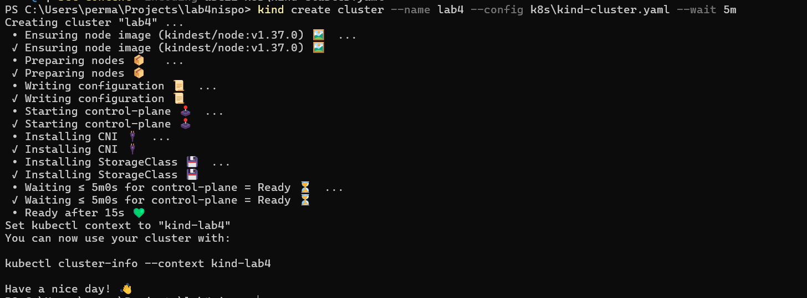
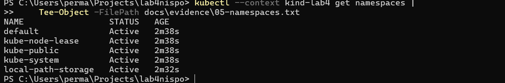
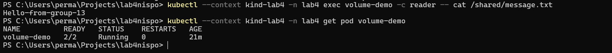
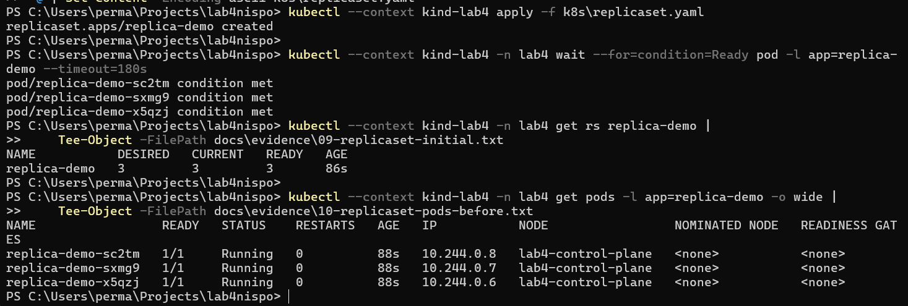
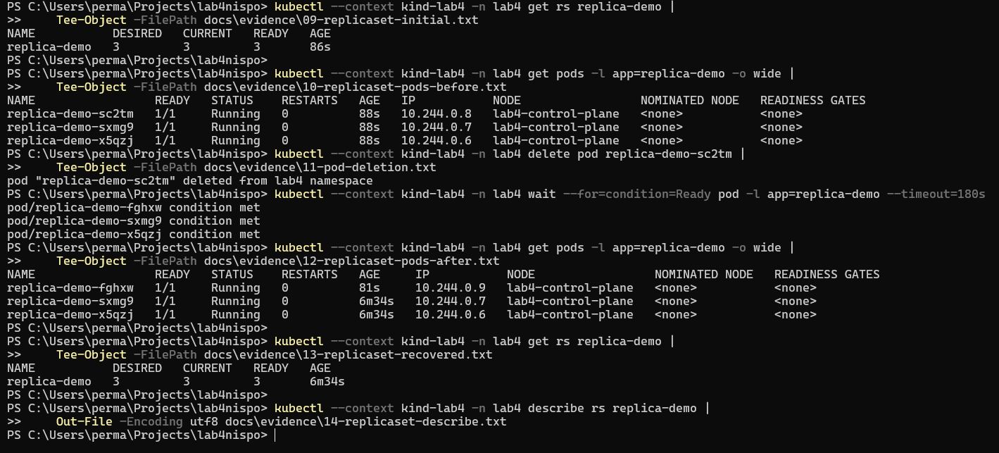
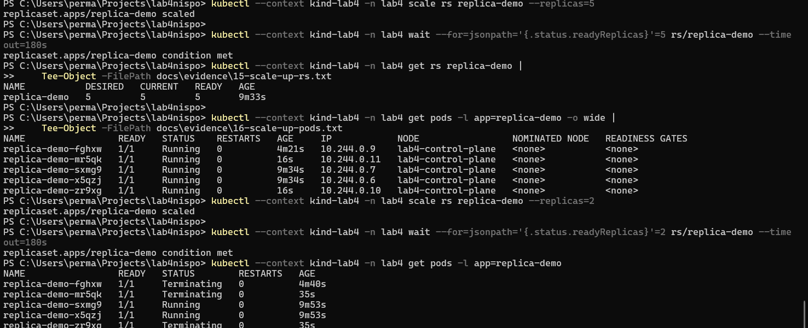
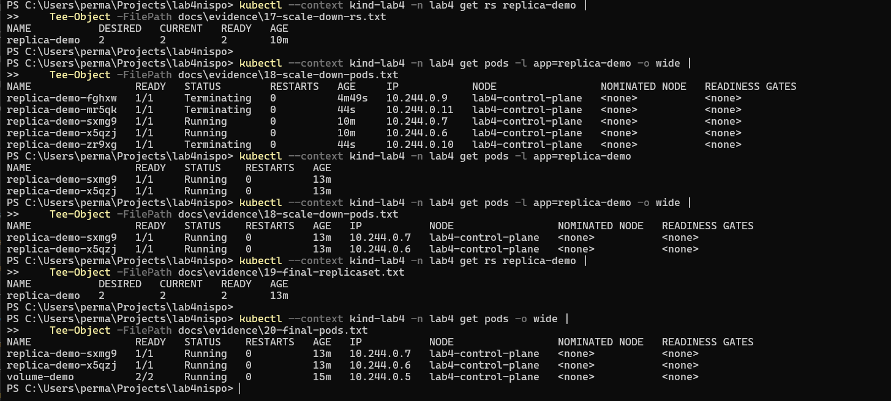
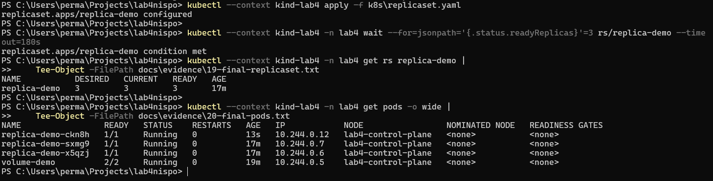

БЕЛОРУССКИЙ ГОСУДАРСТВЕННЫЙ УНИВЕРСИТЕТ

Факультет прикладной математики и информатики

Кафедра технологий программирования

## Отчёт по лабораторной работе № 4

Методы и средства оркестрации в многоконтейнерных системах

Дисциплина: «Непрерывное интегрирование и сборка программного обеспечения»

Выполнил: Шагелдиев Касым

Студент 4 курса, группа 13

Объём работы: задания 1–2


Минск, 2026

## 1. Цель, задание и окружение

Цель: освоить создание локального кластера Kubernetes, исследовать его ресурсы, подключить том к Pod и проверить поддержание числа реплик с помощью ReplicaSet.

По методическим указаниям для группы 13 выполняются задания 1 и 2. Практическое развёртывание Deployment из задания 3 не выполнялось. Ответы на все 23 контрольных вопроса приведены отдельно; примеры из этого раздела не являются выполненными экспериментами.

### Использованные средства

Windows, PowerShell, WSL 2; Docker Desktop 4.93.0, Docker Engine 29.8.1; kubectl v1.36.1; kind v0.33.0; Git 2.56.0.windows.1. Узел Kubernetes v1.37.0, Debian GNU/Linux 13, containerd 2.3.4. Значения зафиксированы по выводу команд в ходе работы.

Рабочая папка: C:\Users\perma\Projects\lab4nispo. Кластер: lab4, контекст: kind-lab4, пространство имён практических ресурсов: lab4.

### Порядок выполнения

1. Подготовка Docker, kubectl, kind и Git. 2. Создание кластера. 3. Исследование ресурсов и компонентов. 4. Монтирование общего тома. 5. Создание, восстановление и масштабирование ReplicaSet. 6. Сохранение доказательств и оформление отчёта.

### Конфигурация кластера

```yaml
kind: Cluster
apiVersion: kind.x-k8s.io/v1alpha4
nodes:
  - role: control-plane
```

```yaml
kind create cluster --name lab4 --config k8s/kind-cluster.yaml --wait 5m
kubectl --context kind-lab4 cluster-info
kubectl --context kind-lab4 get nodes -o wide
kubectl --context kind-lab4 get pods -A
```

## 2. Работающий кластер

Узел lab4-control-plane перешёл в состояние Ready. API доступен по локальному адресу https://127.0.0.1:61742. Все девять системных Pod в первоначальном выводе имели состояние Running, готовность 1/1 и ноль перезапусков. Адрес и порт относятся к данному запуску.

Рисунок 1. Работающий кластер и системные Pod.



### Исследование ресурсов

```yaml
kubectl --context kind-lab4 api-resources
kubectl --context kind-lab4 get namespaces
```

Рисунок 2. Пространства имён кластера.



## 3. Назначение компонентов

### kube-apiserver

Обрабатывает обращения к API, проверяет запросы и служит точкой взаимодействия компонентов.

### etcd

Хранит конфигурацию и состояние объектов кластера.

### kube-scheduler

Выбирает подходящий узел для новых Pod с учётом ограничений и ресурсов.

### kube-controller-manager

Выполняет циклы контроллеров, согласующие фактическое состояние с желаемым.

### kube-proxy

Реализует сетевые правила Service на узле.

### kindnet

Обеспечивает сетевую связность Pod в kind.

### CoreDNS (2 Pod)

Разрешает DNS-имена внутри кластера, в частности имена Service.

### local-path-provisioner

Выделяет локальное хранилище по запросам PVC через соответствующий StorageClass.

### kubelet и containerd

Работают на узле, отдельно от перечисленных Pod: kubelet контролирует выполнение Pod, containerd запускает контейнеры.

Пространства имён: default для ресурсов без явно заданного namespace; kube-system для системных компонентов; kube-public для общедоступной информации; kube-node-lease для объектов Lease узлов; local-path-storage для provisioner. Для лабораторных ресурсов создано отдельное пространство lab4.

## 4. Pod с общим томом

```yaml
apiVersion: v1
kind: Namespace
metadata:
  name: lab4
```

```yaml
apiVersion: v1
kind: Pod
metadata:
  name: volume-demo
  namespace: lab4
spec:
  containers:
    - name: writer
      image: busybox:1.37.0
      command: ["sh", "-c", "sleep 86400"]
      volumeMounts:
        - name: shared-data
          mountPath: /data
    - name: reader
      image: busybox:1.37.0
      command: ["sh", "-c", "sleep 86400"]
      volumeMounts:
        - name: shared-data
          mountPath: /shared
          readOnly: true
  volumes:
    - name: shared-data
      emptyDir: {}
```

Один emptyDir shared-data смонтирован в writer по пути /data, а в reader по пути /shared только для чтения. Том общий для контейнеров этого Pod; данные сохраняются при перезапуске контейнера, но удаляются вместе с Pod. PV/PVC в данном эксперименте не создавались.

## 5. Проверка монтирования

```yaml
kubectl --context kind-lab4 apply -f k8s/namespace.yaml
kubectl --context kind-lab4 apply -f k8s/pod-volume.yaml
kubectl --context kind-lab4 -n lab4 exec volume-demo -c writer -- \
  sh -c 'echo Hello-from-group-13 > /data/message.txt'
kubectl --context kind-lab4 -n lab4 exec volume-demo -c reader -- \
  cat /shared/message.txt
```

В листинге длинные команды визуально перенесены с символом \. В PowerShell следует вводить каждую команду одной строкой (\ не является символом продолжения PowerShell).

Результат чтения: Hello-from-group-13. Pod volume-demo: 2/2 Running. Запись выполнена через writer, чтение через reader; это подтверждает доступ к одному тому из разных контейнеров. Проверка запрета записи из reader отдельно не выполнялась.

Рисунок 3. Чтение общего тома из контейнера reader.



## 6. ReplicaSet

```yaml
apiVersion: apps/v1
kind: ReplicaSet
metadata:
  name: replica-demo
  namespace: lab4
spec:
  replicas: 3
  selector:
    matchLabels:
      app: replica-demo
  template:
    metadata:
      labels:
        app: replica-demo
    spec:
      containers:
        - name: busybox
          image: busybox:1.37.0
          command: ["sh", "-c", "sleep 86400"]
```

Поле replicas задаёт три реплики. Селектор app: replica-demo совпадает с меткой шаблона Pod. Pod volume-demo этой метки не имеет и не входит в ReplicaSet.

```yaml
kubectl --context kind-lab4 apply -f k8s/replicaset.yaml
kubectl --context kind-lab4 -n lab4 get rs replica-demo
kubectl --context kind-lab4 -n lab4 get pods -l app=replica-demo
```

Рисунок 4. ReplicaSet: три готовые реплики.



## 7. Самовосстановление

Удалён Pod replica-demo-sc2tm. ReplicaSet создал новый Pod replica-demo-fghxw, сохранив требуемое количество реплик. Это новый объект Pod, а не перезапуск прежнего. Два остальных Pod сохранили имена.

```yaml
kubectl --context kind-lab4 -n lab4 delete pod replica-demo-sc2tm
kubectl --context kind-lab4 -n lab4 get pods -l app=replica-demo
kubectl --context kind-lab4 -n lab4 get rs replica-demo
```

Рисунок 5. Удаление Pod и создание замены.



## 8. Масштабирование

```yaml
kubectl --context kind-lab4 -n lab4 scale rs replica-demo --replicas=5
kubectl --context kind-lab4 -n lab4 scale rs replica-demo --replicas=2
```

После увеличения ReplicaSet показал DESIRED/CURRENT/READY = 5/5/5. При уменьшении три Pod сначала находились в Terminating; после завершения удаления остались два Running.

Рисунок 6. Увеличение до пяти реплик.



Рисунок 7. Завершённое уменьшение до двух реплик.



## 9. Итоговая проверка

Команда apply восстановила исходную конфигурацию replicas: 3 из файла. Финальный ReplicaSet: 3/3/3. Работают replica-demo-ckn8h, replica-demo-sxmg9 и replica-demo-x5qzj (1/1), а также volume-demo (2/2).

Рисунок 8. Возврат к трём репликам и итоговое состояние.



### Результаты проверок

Кластер: Ready. Системные Pod: Running. Общий том: записанный файл прочитан другим контейнером. ReplicaSet: три реплики. Самовосстановление: новый Pod после удаления. Масштабирование: 3 → 5 → 2. Возврат к манифесту: три реплики.

### Вывод

Выполнена практическая часть заданий 1–2 для группы 13. Получены навыки работы с kubectl, пространствами имён, Pod, томами и ReplicaSet. Продемонстрировано согласование фактического количества Pod с заданным. Скриншоты отражают реальные результаты; собственное приложение в этой работе не разрабатывалось.

## 10. Контрольные вопросы

Следующие ответы и YAML-фрагменты являются теоретическими. Они не означают выполнение дополнительных экспериментов с Service, Ingress, Deployment или хранилищем PV/PVC.

### 1. Что такое Kubernetes?

Kubernetes — система оркестрации контейнерных приложений. Пользователь задаёт желаемое состояние ресурсов, а контроллеры поддерживают его: размещают Pod, восстанавливают реплики и обеспечивают управление конфигурацией и обновлениями.

### 2. Docker вручную и Kubernetes

При ручном запуске Docker пользователь самостоятельно выбирает хосты, запускает экземпляры и организует восстановление и сеть. Kubernetes управляет группой узлов через API и декларативные ресурсы; контейнеры запускает среда выполнения на узле. Он не заменяет сборку образов.

### 3. Где оркестрация экономит время?

Пример 1: после удаления экземпляра веб-приложения контроллер автоматически создаёт замену. Пример 2: при росте нагрузки число экземпляров увеличивается изменением replicas, без ручного запуска каждого контейнера.

### 4. Основные компоненты

Control plane: API server — API; etcd — хранилище состояния; scheduler — выбор узла; controller manager — контроллеры. На узлах: kubelet — управление Pod, container runtime — запуск контейнеров, сетевой компонент — маршрутизация Service (в этой работе kube-proxy). DNS и CNI дополняют базовые компоненты. Назначение реально наблюдавшихся Pod приведено в разделе 3.

### 5. Как создать Pod через YAML?

Создать манифест и выполнить kubectl apply -f pod.yaml. apiVersion определяет версию API, kind — тип ресурса, metadata — имя, namespace и метки, spec — желаемое устройство Pod. Для обычного Pod нужен непустой список containers с именами и образами.

### 6. Пример Pod и обязательные поля

В следующем примере 12 строк. apiVersion: v1 выбирает API Pod; kind: Pod — тип объекта; metadata.name — имя; spec.containers описывает контейнер. Отсутствие необходимых полей или неверный тип значения приводит к ошибке декодирования/валидации, ресурс не создаётся. Некоторые необязательные поля получают значения по умолчанию.

```yaml
apiVersion: v1
kind: Pod
metadata:
  name: simple-pod
  labels:
    app: demo
spec:
  containers:
    - name: worker
      image: busybox:1.37.0
      command: ["sh", "-c", "sleep 3600"]
  restartPolicy: Always
```

### 7. ClusterIP и Headless

Service задаёт устойчивую точку обнаружения набора Pod. ClusterIP предоставляет виртуальный IP: например, веб-приложение обращается к db по одному адресу. Headless (clusterIP: None) не выделяет виртуальный IP; DNS для Service с селектором возвращает адреса подходящих Pod. Это удобно для выбора конкретных экземпляров базы данных.

### 8. NodePort и LoadBalancer

NodePort: клиент → доступный IP узла:nodePort → сетевые правила Service → IP Pod:targetPort. LoadBalancer: клиент → внешний адрес балансировщика → узел/NodePort либо непосредственно Pod (зависит от реализации) → приложение. Для LoadBalancer нужен поддерживаемый контроллер/провайдер; в обычном kind внешний балансировщик сам не появляется.

### 9. Порты и ограничения NodePort

port — порт Service, targetPort — порт приложения, nodePort — порт узла. Пример: 80 → 8080 и внешний порт 30080. Диапазон nodePort по умолчанию 30000–32767, настраивается на API server. Нужны доступ к IP узла и разрешение firewall; в kind на Windows контейнерный IP узла может быть недоступен извне без публикации портов. containerPort сам по себе порт наружу не публикует.

### 10. Когда выбирать NodePort или LoadBalancer?

NodePort достаточен для стенда в доступной локальной сети. LoadBalancer уместен для публичного сервиса с управляемым внешним адресом и распределением трафика между узлами. Это выбор архитектуры: внешний доступ возможен также через Ingress или отдельно настроенный балансировщик.

### 11. Что такое Ingress?

Ingress описывает HTTP/HTTPS-маршрутизацию по host и path к Service. Для работы нужен Ingress controller; создание одного объекта недостаточно. В примере запрос к lab.example.test с путём / направляется в Service web на порт 80. DNS/hosts должен указывать на адрес контроллера.

```yaml
apiVersion: networking.k8s.io/v1
kind: Ingress
metadata:
  name: web
spec:
  ingressClassName: nginx
  rules:
    - host: lab.example.test
      http:
        paths:
          - path: /
            pathType: Prefix
            backend:
              service:
                name: web
                port:
                  number: 80
```

### 12. Deployment, StatefulSet и DaemonSet

Deployment предназначен для взаимозаменяемых экземпляров, например веб-приложения; создаёт Pod через ReplicaSet без стабильного порядка и привязки к конкретному узлу. При replicas: 3 поддерживает три Pod. StatefulSet предназначен для идентифицируемых экземпляров, например базы данных: стабильные имена и хранилище, по умолчанию OrderedReady; при трёх репликах имена заканчиваются на -0, -1, -2. Постоянной привязки к узлу обычно нет. DaemonSet запускает агент, например сборщик логов, на каждом подходящем узле; поля replicas нет. При трёх подходящих узлах будет три Pod; масштабировать его командой scale до трёх нельзя.

### 13. Job и CronJob

Job выполняет конечную задачу до успешного завершения, например миграцию. CronJob создаёт Job по расписанию, например резервную копию ночью. Проверки: kubectl get jobs; kubectl describe job NAME; kubectl logs job/NAME; kubectl wait --for=condition=complete job/NAME --timeout=120s. Для CronJob сначала находят созданный Job. Результат может быть в логах или внешнем хранилище.

### 14. ConfigMap и Secret; способы передачи

ConfigMap хранит обычные настройки, Secret — чувствительные значения. Первый способ: переменные окружения через env/valueFrom или envFrom, удобно для небольших параметров; обновление объекта не изменяет окружение уже работающего процесса. Второй: файлы через volumes и volumeMounts, удобно для конфигурационных файлов. Обновления смонтированных файлов распространяются не мгновенно; приложение должно перечитать их. Монтирование через subPath не получает автоматических обновлений.

```yaml
# Фрагмент spec.containers[]: переменная окружения
 env:
   - name: MODE
     valueFrom:
       configMapKeyRef:
         name: app-config
         key: mode
# Фрагменты Pod: файл из Secret
# spec.containers[].volumeMounts:
 volumeMounts:
   - name: credentials
     mountPath: /etc/credentials
     readOnly: true
# spec.volumes:
 volumes:
   - name: credentials
     secret:
       secretName: app-secret
```

### 15. Примеры ConfigMap и Secret

ConfigMap не предназначен для секретных данных: настройки могут быть доступны более широкому кругу пользователей. Secret позволяет отдельно ограничивать доступ через RBAC, но base64 не является шифрованием; нужны защита доступа и шифрование хранения. Следующий пароль исключительно учебный; реальные секреты нельзя коммитить в Git.

```yaml
apiVersion: v1
kind: ConfigMap
metadata:
  name: app-config
data:
  mode: "demo"
---
apiVersion: v1
kind: Secret
metadata:
  name: app-secret
type: Opaque
stringData:
  password: "example-only-not-a-real-password"
```

### 16. Основные команды kubectl

Состояние: get, describe, api-resources. Создание/изменение: apply, scale. Удаление: delete. Отладка: logs, exec, port-forward. Обновления: rollout. Примеры: kubectl get pods -A; kubectl describe pod NAME; kubectl apply -f file.yaml; kubectl logs NAME; kubectl exec NAME -- COMMAND. Всего перечислено десять основных команд/групп.

### 17. Пространства имён

Namespace разделяет имена и область действия ресурсов: одинаковое имя Pod допустимо в разных namespaces. Примеры: dev/stage/prod, команды разработки, временные лабораторные стенды. Namespace сам по себе не обеспечивает полную сетевую изоляцию: нужны NetworkPolicy и соответствующая сеть; права определяет RBAC. Узлы и PV относятся к ресурсам уровня кластера.

### 18. Создание namespace

Команды: kubectl create namespace lab4; kubectl -n lab4 get pods. Декларативный вариант — Namespace-манифест из раздела 4. Для изменения namespace текущего контекста: kubectl config set-context --current --namespace=lab4. В работе namespace и контекст задавались явно.

### 19. Пробы контейнеров

livenessProbe обнаруживает зависший контейнер и после порога ошибок вызывает его перезапуск. readinessProbe определяет готовность принимать трафик: неготовый Pod исключается из готовых endpoints Service без обязательного перезапуска. startupProbe даёт приложению время на запуск; до её успеха liveness/readiness не выполняются. Пробы могут использовать HTTP, TCP, exec или gRPC.

### 20. PV и PVC

PV описывает предоставленный ресурс хранения, PVC — запрос приложения на объём, режим доступа и класс. При статическом выделении администратор создаёт PV, подходящий PVC связывается с ним. При динамическом выделении provisioner/CSI по StorageClass создаёт ресурс для PVC; возможна задержка до выбора узла (WaitForFirstConsumer). Pod ссылается на PVC через volume. Дальнейшая судьба данных зависит от reclaimPolicy и backend; локальное хранилище не становится отказоустойчивым автоматически.

### 21. Самовосстановление

1. kubelet перезапускает завершившийся контейнер согласно restartPolicy; liveness может инициировать перезапуск. 2. ReplicaSet заменяет удалённый Pod. 3. При потере узла Kubernetes фиксирует недоступность, а после предусмотренных задержек и удаления/вытеснения Pod контроллер может создать замену на другом подходящем узле. Нужны доступные ресурсы и хранилище. Одиночный Pod без контроллера не восстанавливается как новый объект; одноузловой kind не обеспечивает отказоустойчивость к потере единственного узла.

### 22. Обновление без простоя

RollingUpdate постепенно заменяет старые Pod новыми. maxUnavailable ограничивает число недоступных реплик, maxSurge — дополнительные Pod сверх желаемого числа. Пример: maxUnavailable: 0, maxSurge: 1. Нужны корректная readinessProbe, запас ресурсов, плавное завершение запросов и совместимость версий. Сам выбор стратегии не гарантирует отсутствие простоя.

### 23. Запуск и контроль обновления

Для существующего Deployment web можно изменить image в YAML и выполнить apply либо kubectl set image deployment/web web=nginx:1.28.0. Затем kubectl rollout status deployment/web --timeout=180s; kubectl rollout history deployment/web; kubectl get pods; kubectl describe deployment web. При необходимости kubectl rollout undo deployment/web. Namespace и контекст должны соответствовать приложению. Это теоретический пример; Deployment в данной практике не создавался.

## 11. Источники

### 1. Методические указания к лабораторной работе № 4, М. И. Давидовская, БГУ, Минск, 2026

Предоставленный PDF, страницы 3–8.

### 2. kind: Quick Start

https://kind.sigs.k8s.io/docs/user/quick-start/

### 3. Kubernetes: Workload Management

https://kubernetes.io/docs/concepts/workloads/controllers/

### 4. Kubernetes: Service

https://kubernetes.io/docs/concepts/services-networking/service/

### 5. Kubernetes: Volumes

https://kubernetes.io/docs/concepts/storage/volumes/

### 6. Kubernetes: Secrets

https://kubernetes.io/docs/concepts/configuration/secret/

### 7. Kubernetes: Deployments

https://kubernetes.io/docs/concepts/workloads/controllers/deployment/

Результаты практики подтверждены выводом PowerShell и скриншотами автора. Материалы курса и главы книг, упомянутые в методичке, не представлены как изученные источники данного отчёта.
